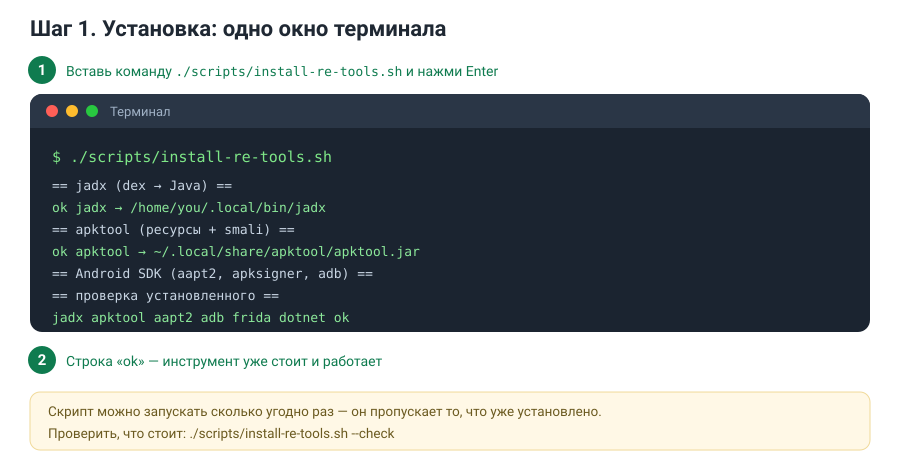
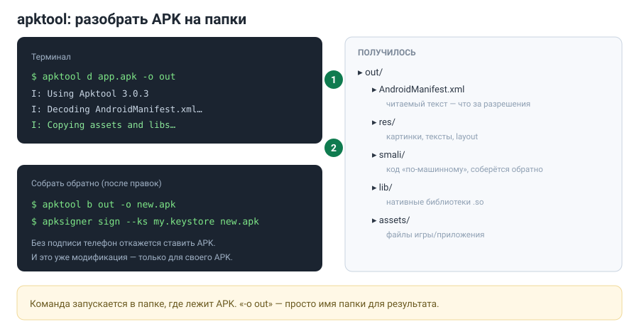
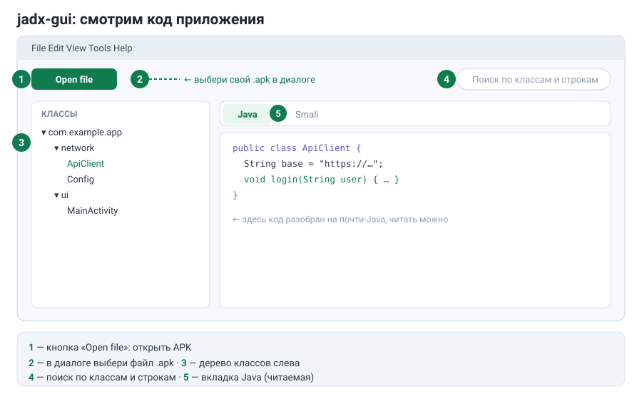
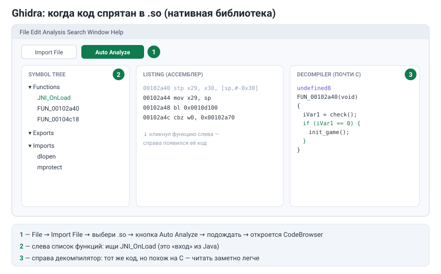
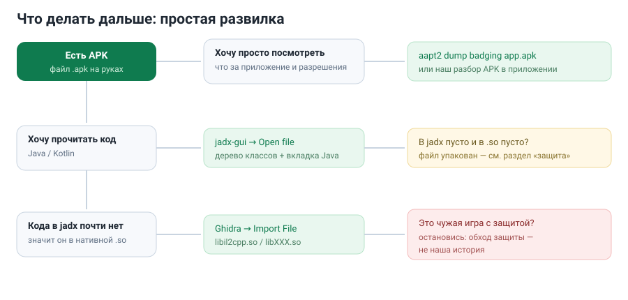

# Разбор APK простыми словами

Версия для тех, кто никогда этого не делал: те же шаги, что в большой инструкции,
но без умных слов. Сначала словарик, потом по шагам, с картинками — куда нажимать.

---

## Словарик: 12 слов, которых хватит

| Слово | Что это по-человечески |
|---|---|
| **APK** | Файл-установщик для Android. Внутри — обычный ZIP: код, картинки, тексты |
| **DEX** | Код приложения в «сжатом» виде. Как `.exe` в Windows, только для Android |
| **Java / Kotlin** | Языки, на которых обычно пишут приложения для Android |
| **jadx** | Программа, которая переводит DEX обратно в почти-Java — чтобы читать |
| **smali** | Тот же код, но записанный «по-машинному» текстом. Можно править и собрать назад |
| **apktool** | Программа, которая распаковывает APK на папки и собирает обратно |
| **ресурсы** | Картинки, надписи, разметка экранов — всё, кроме кода |
| **`.so` / нативная библиотека** | Код, скомпилированный «в машинный». Так делают игры и защиты |
| **Unity / IL2CPP** | Движок, на котором сделано много мобильных игр. Код игры лежит в `libil2cpp.so` |
| **метаданные** | «Оглавление» игры: имена классов и методов в файле `global-metadata.dat` |
| **дизассемблер** | Программа, которая показывает машинный код понятным текстом. Пример — **Ghidra** |
| **root** | «Полные права» на телефоне. Без них нельзя залезать в чужие процессы |

И ещё два слова, которые встретятся:

- **энтропия** — «насколько данные похожи на случайный шум». Если почти 8 — файл,
  скорее всего, зашифрован;
- **дамп** — снимок того, что сейчас лежит в памяти запущенной программы.

---

## Что понадобится

1. Компьютер: Linux, macOS или Windows с WSL (в обычном Windows часть программ не работает).
2. Телефон Android — если захочешь проверять результат (для чтения кода не обязателен).
3. 15 минут и этот документ.

---

## Шаг 1. Установка — одна команда



**Windows:** двойной клик по файлу `scripts\install-re-tools.bat` (или запуск из
`cmd`). Он сам поставит Java, Python, .NET, jadx, apktool, Android SDK и frida —
через `winget` и прямые загрузки. WSL не нужен.

```bat
scripts\install-re-tools.bat --check     :: что уже стоит
scripts\install-re-tools.bat             :: базовый набор
scripts\install-re-tools.bat --full      :: + Ghidra
```

Если файл упрямо не скачивается целым — возьми его в архиве:
<https://github.com/Belopus228/Twinslop/releases/download/hands/re-tools-windows.zip>
(внутри `install-re-tools.bat` и `readme.txt`).

**Linux / macOS:** открой терминал в папке с репозиторием и вставь:

```bash
./scripts/install-re-tools.sh
```

Что произойдёт: скрипт сам скачает и поставит `jadx`, `apktool`, Android SDK
(`aapt2`, `adb`), `androguard`, `dex2jar`, `Il2CppDumper`, `frida-tools`.

Проверить, что всё встало:

```bash
./scripts/install-re-tools.sh --check
```

Если хочешь ещё и Ghidra (тяжёлая, ~450 МБ) — добавь `--full`.

> Не знаешь, что такое «терминал»? Это чёрное окно, куда печатают команды.
> В Ubuntu — `Ctrl+Alt+T`, в macOS — программа «Терминал», в Windows — «Ubuntu» из меню Пуск.

---

## Шаг 2. Первый взгляд: что вообще внутри



Самое быстрое — посмотреть список файлов. APK это ZIP, поэтому:

```bash
unzip -l app.apk | head -n 40
```

Ты увидишь примерно это (справа — простыми словами):

| Строка | Что значит |
|---|---|
| `AndroidManifest.xml` | «Паспорт» приложения: имя, версия, разрешения |
| `classes.dex`, `classes2.dex` | Код |
| `res/` | Картинки и тексты |
| `lib/arm64-v8a/*.so` | Код, скомпилированный в машинный (игры, защиты) |
| `assets/` | Файлы игры: уровни, звуки, данные |

Или одной командой с готовым отчётом:

```bash
./scripts/apk-triage.sh app.apk
```

Скрипт напишет: сколько внутри кода, под какую архитектуру, что за движок и
не спрятано ли всё за шифрованием.

---

## Шаг 3. Прочитать код: jadx-gui



1. Запусти `jadx-gui` (можно просто напечатать в терминале).
2. Нажми **Open file** (кнопка **1** на картинке).
3. Выбери свой `.apk` (**2**).
4. Слева появится дерево классов (**3**) — как папки в проводнике.
5. Кликай по классам: справа покажется код (**5**). Вкладка **Java** — читаемая,
   **Smali** — машинная.

Полезное:

- **Поиск** (**4**) ищет по всем классам и строкам: вбей `http`, `token`, `key`.
- Если у класса «пустое» тело метода — значит код лежит не здесь, а в `.so` (Шаг 6).

То же самое без окна, из терминала:

```bash
jadx -d out/jadx app.apk
# результат: out/jadx/sources/… — обычные .java файлы
```

---

## Шаг 4. Разобрать на папки: apktool

Нужно, если хочешь посмотреть **ресурсы** (картинки, тексты) или **править smali**.

```bash
apktool d app.apk -o out
```

Получится папка `out/` с `AndroidManifest.xml` в читаемом виде, `res/`, `smali/`,
`assets/`, `lib/`.

Обратно собрать (только для своего приложения!):

```bash
apktool b out -o new.apk
apksigner sign --ks my.keystore new.apk
```

Без подписи телефон откажется ставить APK — это защита Android, а не ошибка.

---

## Шаг 5. Если это игра на Unity

Как понять: в списке файлов есть `libil2cpp.so`. Тогда код игры — не в `classes.dex`,
а в двух файлах:

```
lib/arm64-v8a/libil2cpp.so                       — сам код
assets/bin/Data/Managed/Metadata/global-metadata.dat — «оглавление» с именами
```

Шаги:

```bash
unzip -p app.apk lib/arm64-v8a/libil2cpp.so > libil2cpp.so
unzip -p app.apk assets/bin/Data/Managed/Metadata/global-metadata.dat > gm.dat

# первая проверка: файл должен начинаться с магии FAB11BAF
xxd -l 4 gm.dat

dotnet Il2CppDumper.dll libil2cpp.so gm.dat out/
```

Что получится: файл `dump.cs` — список классов и методов с адресами.

**Важно:** в `dump.cs` только **названия** и адреса, а не сам код. Тела методов —
это машинный код, его читают в Ghidra (следующий шаг).

Если `xxd` показал не `fab11baf`, а что-то другое — метаданные зашифрованы.
Тогда читать нечего: см. раздел «Если файл защищён».

---

## Шаг 6. Код в .so: Ghidra



1. Запусти Ghidra → **File → Import File** → выбери `.so` (**1**).
2. Нажми **Auto Analyze**, подожди (минуту-две, зависит от размера).
3. Слева откроется список функций (**2**): ищи `JNI_OnLoad` — это «вход» из Java.
4. Справа — декомпилятор (**3**): тот же код, но в виде, похожем на C. Читать проще.

Совет: не пытайся понять всё. Найди строки (`Search → For Strings`), зацепись за
них, и иди от простого к сложному.

---

## Шаг 7. Посмотреть на живую программу (по желанию)

Нужен телефон по USB и включённая отладка.

```bash
adb devices            # проверить, что телефон виден
adb logcat | grep -i error    # что программа пишет в журнал
```

Хочешь больше — Frida (подключается к запущенной программе). Это уже требует
root, и напоминание: **только для своих приложений**.

---

## Развилка: что делать, если…



| Ситуация | Что делать |
|---|---|
| Просто узнать, что за приложение | `aapt2 dump badging app.apk` или наш 📦 в приложении |
| Нужен код | `jadx-gui` |
| Нужны картинки/тексты | `apktool d app.apk` |
| Это Unity-игра | Шаг 5: `Il2CppDumper` |
| В jadx пусто, а `.so` большие | Шаг 6: Ghidra |
| Везде «мусор» и высокая энтропия | файл защищён, см. ниже |

---

## Если файл защищён

Признаки: `global-metadata.dat` не начинается с `fab11baf`; `.so` весит много, а
читаемых строк в нём почти нет; в dex почти пусто.

Это значит: данные зашифрованы, и **в файле** их прочитать нельзя — ключ появляется
только когда программа запущена. Тут инструкция заканчивается, и вот почему:

- расшифровка делается специальными средствами на телефоне с root;
- это обход защиты — по закону нельзя (ст. 1299 ГК РФ, DMCA §1201);
- в мультиплеерных играх это ещё и читерство, за которое банят аккаунт.

Наш скрипт `apk-triage.sh` в такой ситуации честно пишет: «файл защищён,
статически не читается».

---

## Частые затыки

| Что видишь | Что это значит |
|---|---|
| `command not found: jadx` | не открыл новый терминал после установки (PATH). Открой заново |
| `jadx не является внутренней командой` (Windows) | то же самое: закрой и открой `cmd` заново |
| Windows ругается «открыть этот файл» | правый клик по `.bat` → «Запуск от имени администратора» не нужен, просто двойной клик |
| `'ll" ( set "MODE' is not recognized`, `'енты' is not recognized` | файл скачался побитым (другие переводы строк). Скачай `install-re-tools.bat` заново **кнопкой Raw / Download**, а не копированием текста. Файл хранится в кодировке Windows-1251 — не пересохраняй его в UTF-8 |
| `jadx`: классы есть, код пустой | код в `.so` → Шаг 6 |
| `apktool`: ошибка `brut.androlib` | APK битый: проверь `unzip -t app.apk` |
| `Il2CppDumper`: `code=-6` | метаданные зашифрованы, версию менять бесполезно |
| Ghidra: «cannot import» | выбрал не тот тип файла: нужен `.so`, не `.apk` |
| Везде каша и «нечитаемые» символы | файл упакован/зашифрован |
| `adb: no devices` | телефон не в режиме отладки или не подтвердил доступ на экране |

---

## Куда идти дальше

- Полная версия с деталями: **`docs/REVERSE-APK.md`**
- Проверить APK одной командой: **`scripts/apk-triage.sh app.apk`**
- Поставить инструменты: **`scripts/install-re-tools.sh`**

И главное: разбирай **свои** приложения и то, на что есть разрешение. Всё
остальное — не «реверс», а нарушение.
